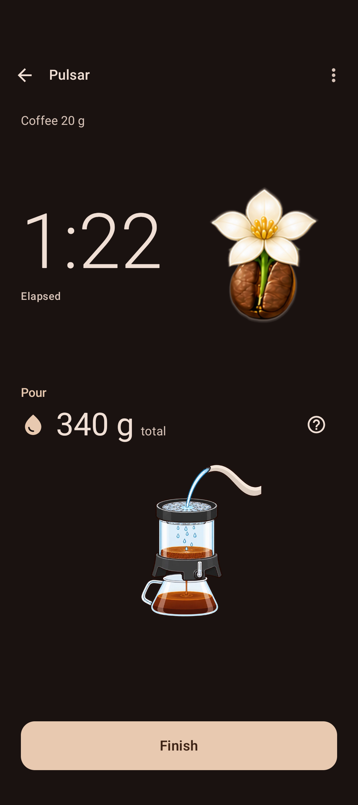
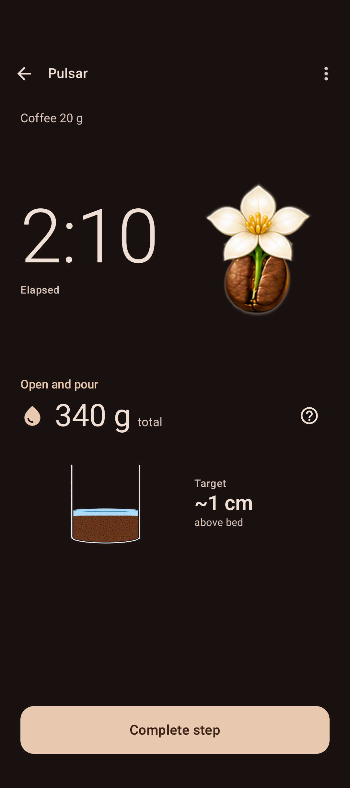
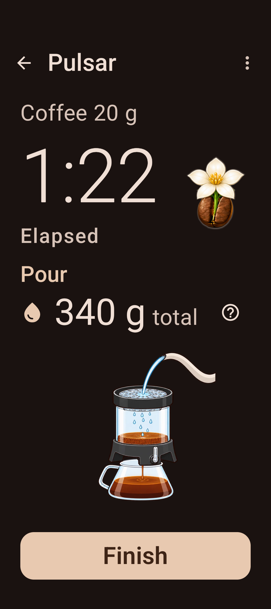
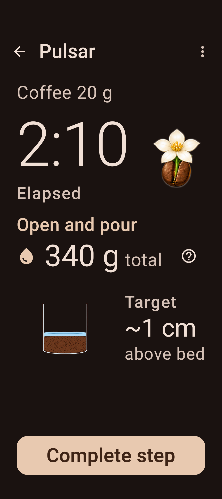
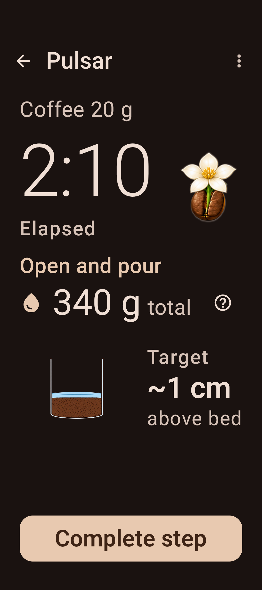
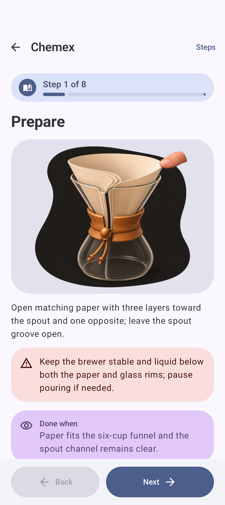
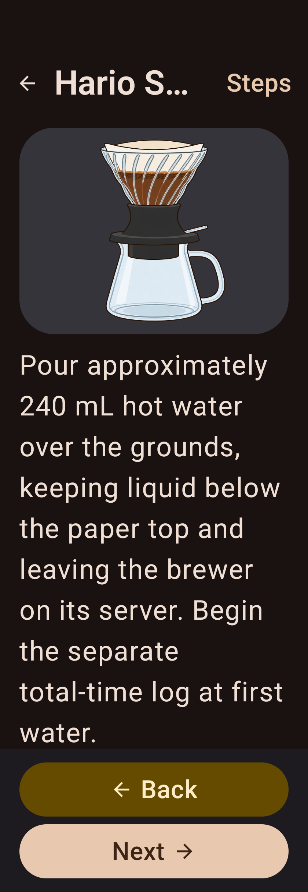
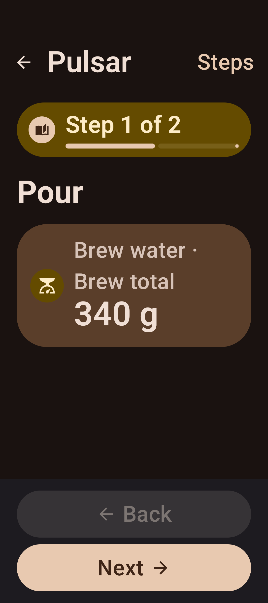
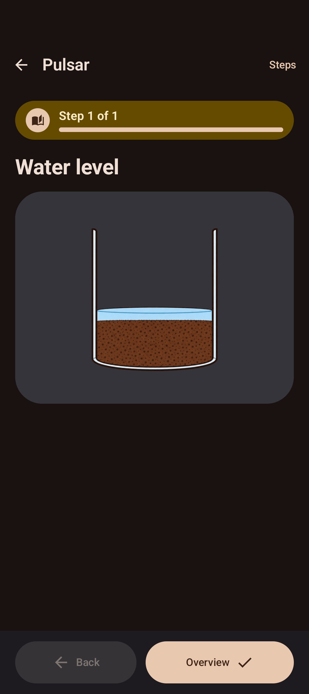

# Native screenshots

Actual Android API37 renders. Before: unchanged base 7caf5278. After: adaptive presentation implementation. Live layout intentionally retains its established hierarchy.

| Screen | Before | After |
| --- | --- | --- |
| Basic Timer |  |  |
| Guided pour |  |  |
| Basic Timer, 200% at320dp |  |  |
| Guided pour, 200%, cue scrolled into view |  |  |
| Chemex reader |  |  |
| Switch reader, 200% at320dp |  |  |

## Optional-content examples

Native fixtures feed the same production reader directly. They demonstrate independently supplied content rather than alternate screen implementations.

