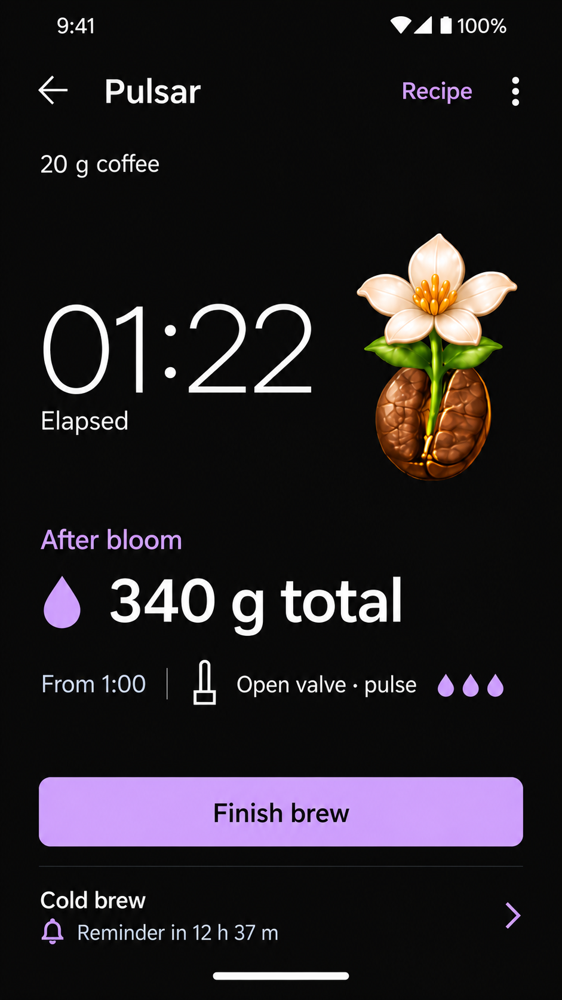
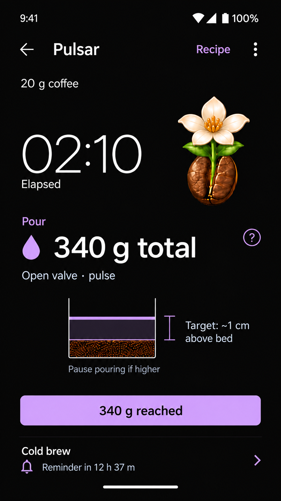

# Focused visual-first concepts

Two image-generator mockups, 2026-10-09, following the selected minimal theme and the project-wide visual-first principle. Static proposals; no app code or native assets changed.

## Basic timer and concurrent brew

Clock, coffee dose, cumulative water target and one conditional reference cue. Finish brew affects the foreground session; the cold-brew row identifies a separate reminder.

## Guided pour

Current cumulative target with one schematic water-height cue. The bracket measures above the coffee bed; Target identifies an instruction rather than a sensor reading. The report action remains separate from basic Finish brew.

The final bloom-animation pose remains in both views. Generated artwork approximates the existing atlas, which stays authoritative. Astra reviewed both images and found no blocking issues. Static review cannot validate comprehension, device layout, accessibility, interactions, animation or reminder delivery.

Exact built-in generator inputs are in [prompts.json](prompts.json); original output paths and hashes are in [manifest.json](manifest.json).
