# Expressive brewing UI — before and after

Actual native renders on the existing stable API37 emulator. Before captures are the verified 4019dcac layout, preserved from the preceding pass. After captures use the matching fixtures with this change. Screenshot pixels are unmodified.

Normal live captures are 411.43 dp at 100% text. Large live captures use 320 dp at 200% text through fixture-local density; device settings are unchanged. The six availability cases share a frozen 2:10 elapsed, 340g target and completed bloom.

| View | Before | After |
| --- | --- | --- |
| Basic Timer / normal | 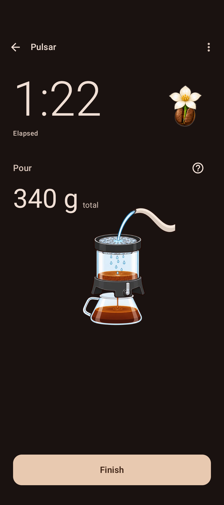 | 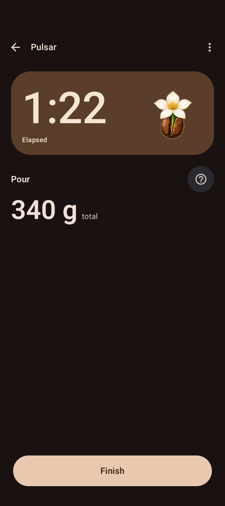 |
| Basic Timer / 200% | 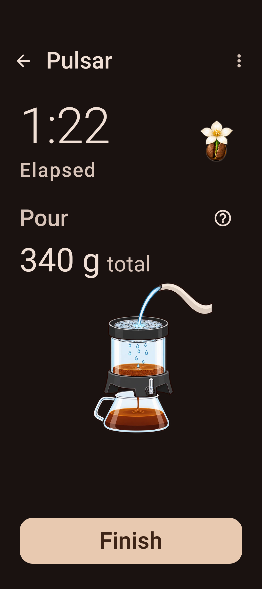 | 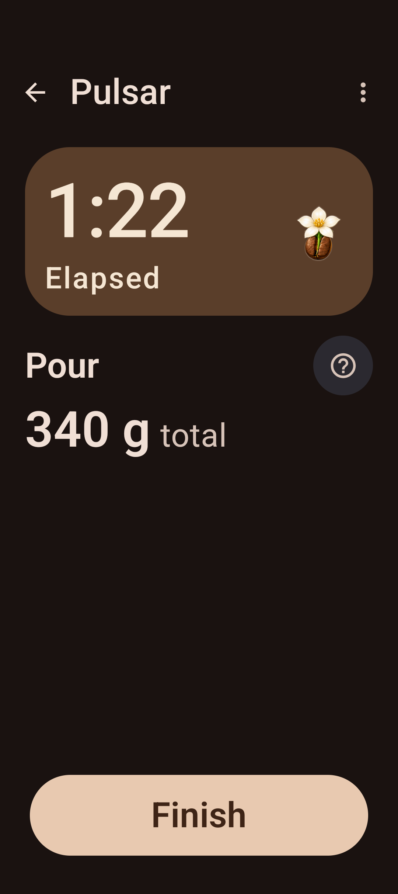 |
| Full guidance / normal | 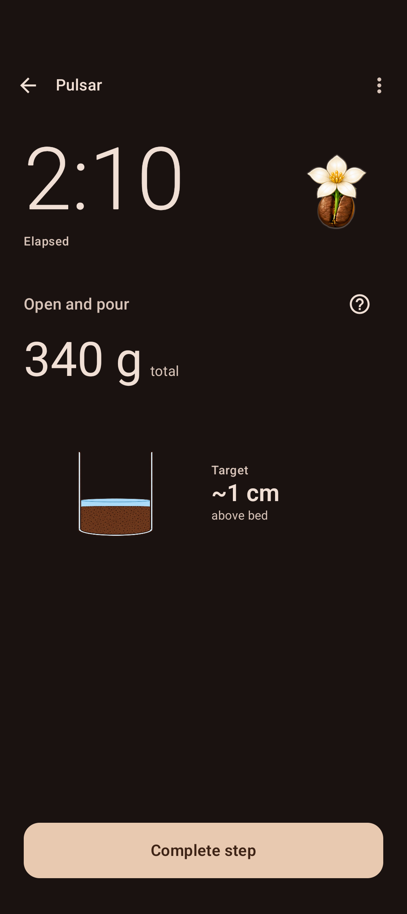 | 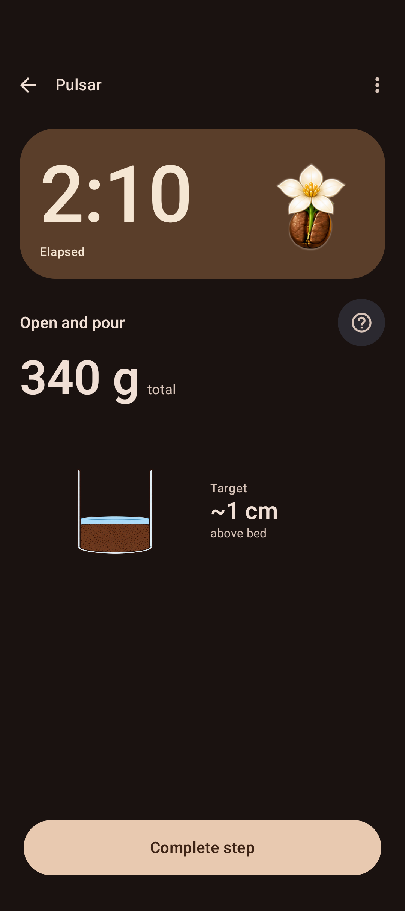 |
| Full guidance / 200% | 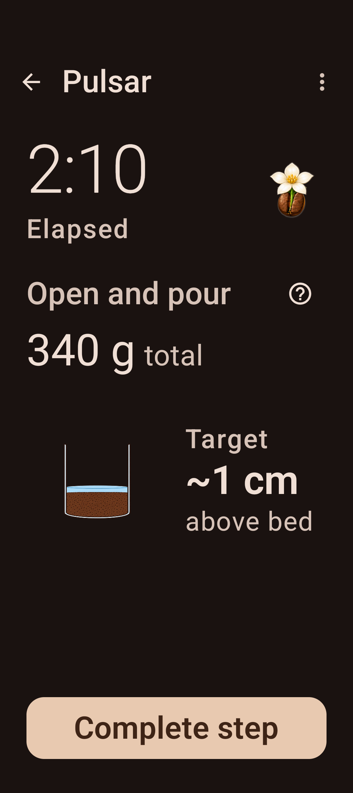 | 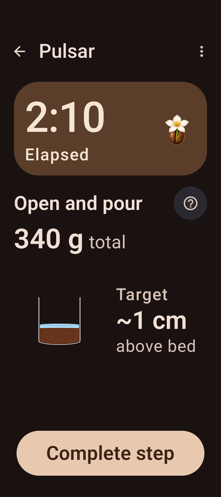 |
| Partial guidance / normal | 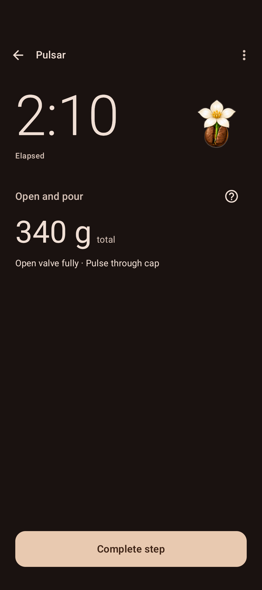 | 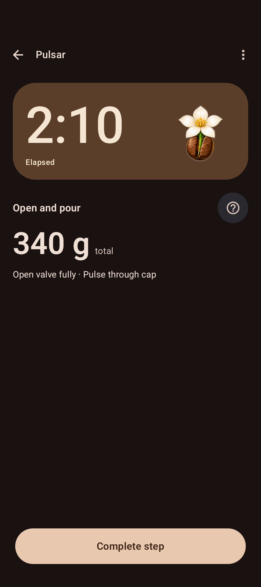 |
| Partial guidance / 200% | 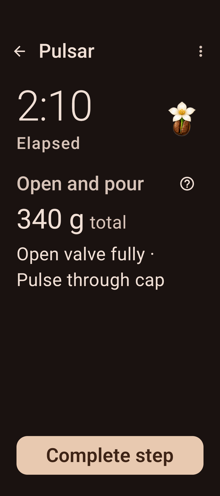 | 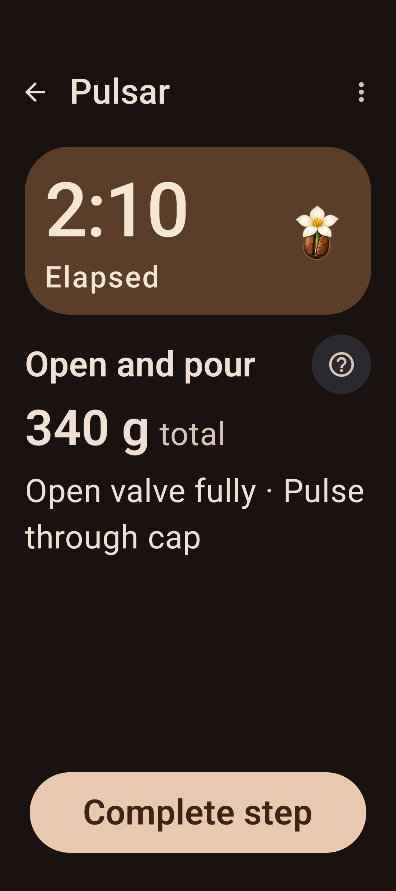 |
| Missing guidance / normal | 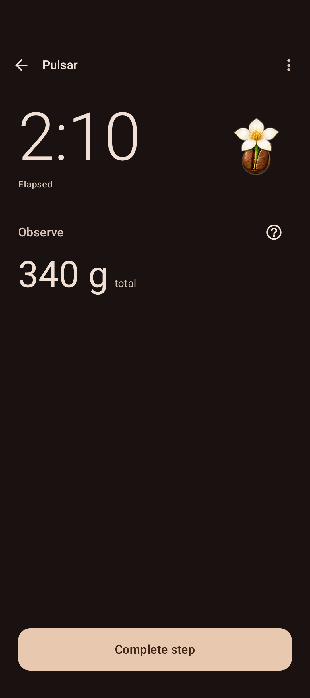 | 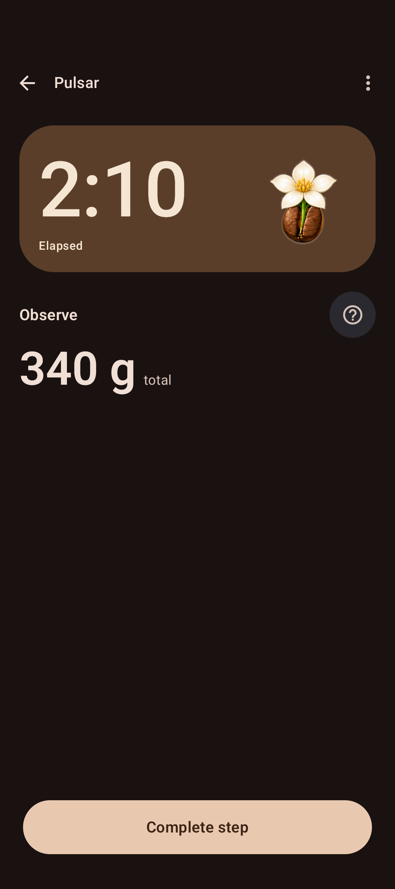 |
| Missing guidance / 200% | 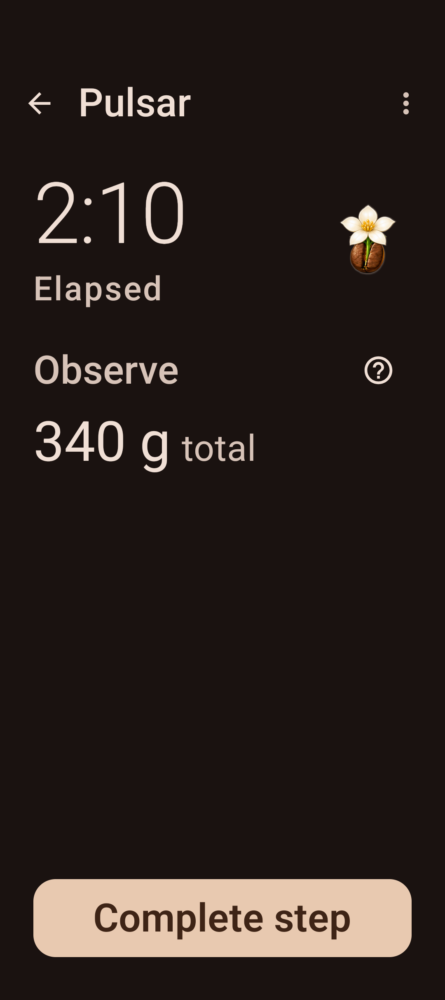 | 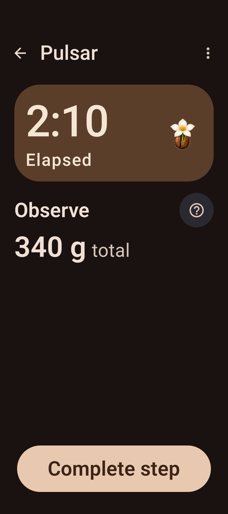 |
| Reviewed reader / normal |  | 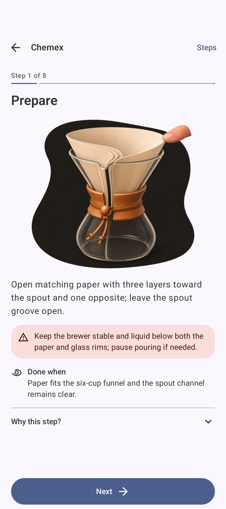 |
| Volume reader / 200% | 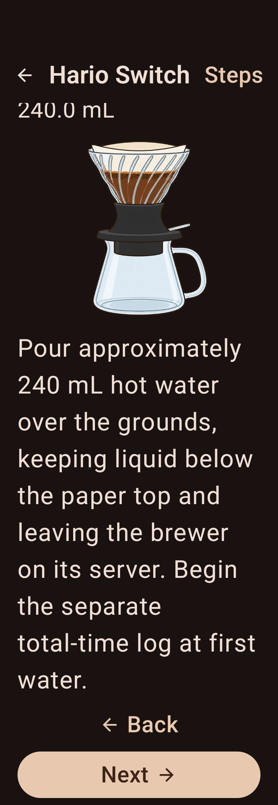 | 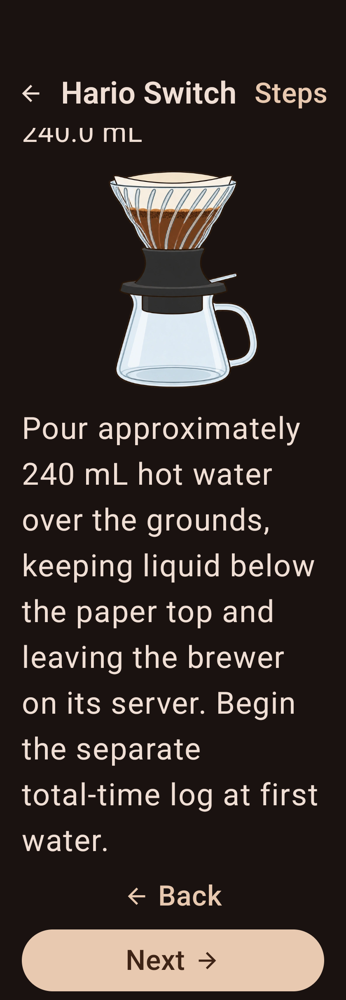 |
| Targets only / 200% | 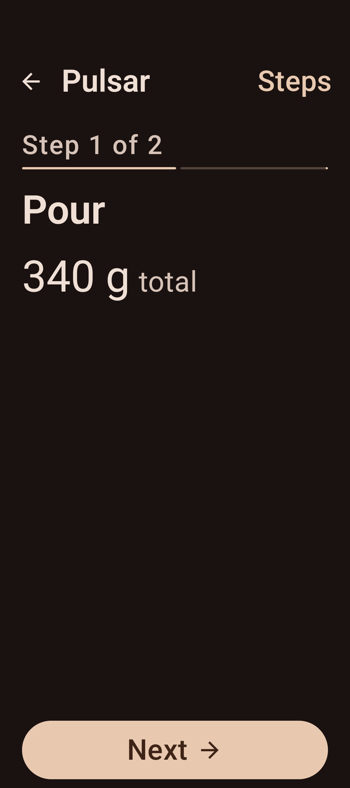 |  |
| Image only / normal | 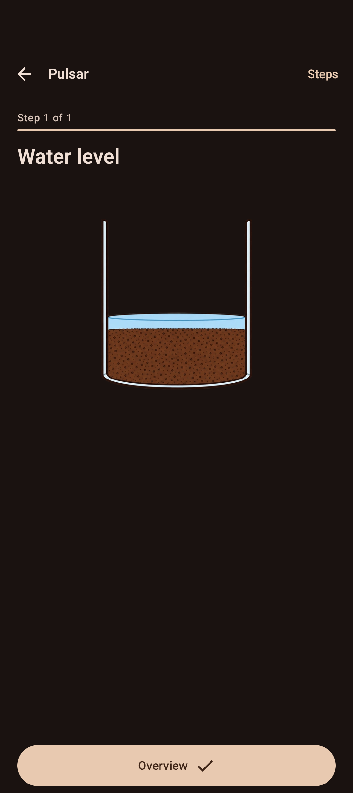 |  |

Basic Timer and missing guidance retain only the bloom as non-icon imagery. Full or partially supplied guidance keeps relevant admitted art when it exists. Help remains explicit access to source guidance.

[Native primary action while pressed](evidence/after/primary-pressed.png) demonstrates the Expressive shape state. The gesture is canceled, and the test verifies that pressing alone never confirms a physical brewing step. Spatial motion is additionally checked with controlled-clock intermediate bounds and interrupted disclosure reversal; static screenshots alone do not prove motion.

Some reader captures intentionally show the existing test scroll position. Popup sheets keep the emulator window font configuration; 200% live content does not establish 200% popup typography.

The normal reviewed-reader and image-only idle captures intentionally match the baseline. Their changes are press feedback and transition motion; the other ten idle comparison pairs show visible layout changes.
