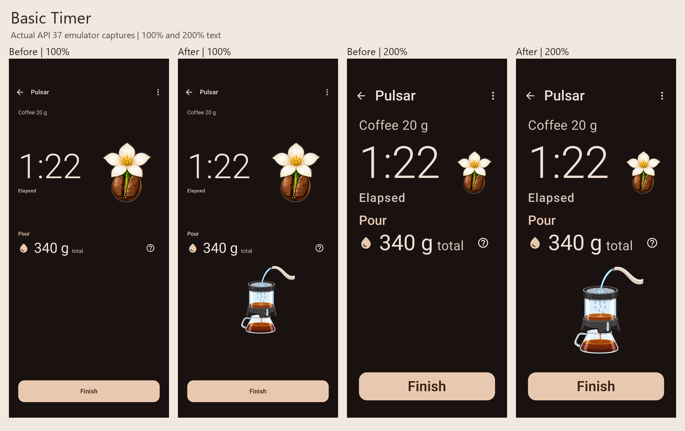
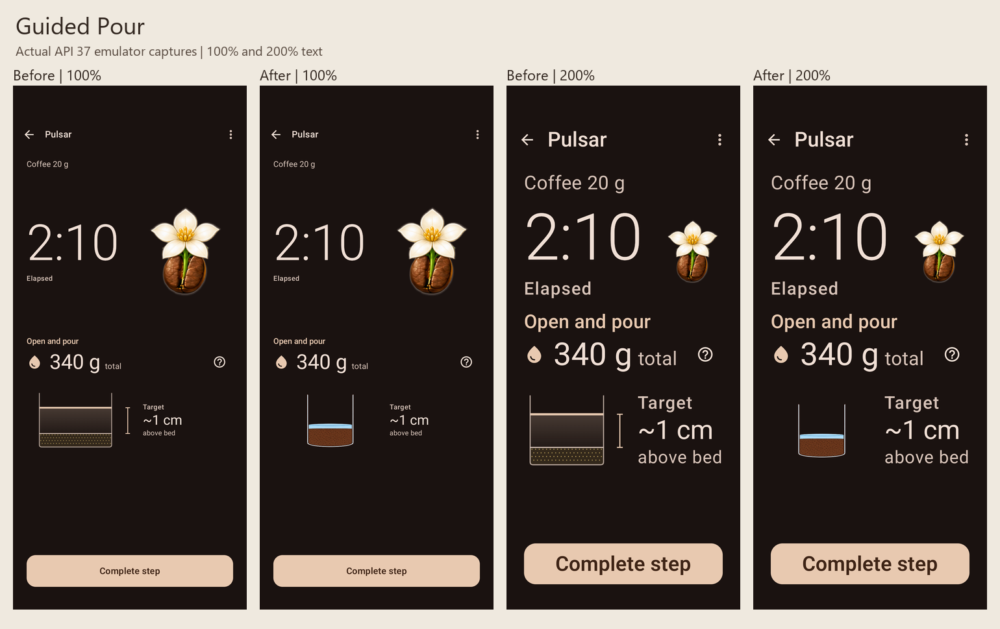
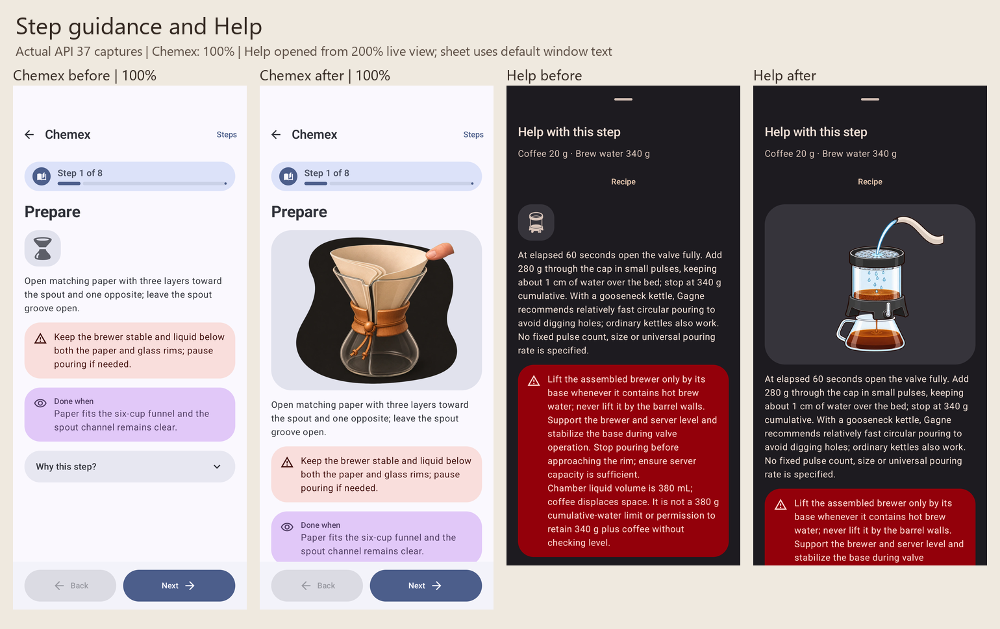
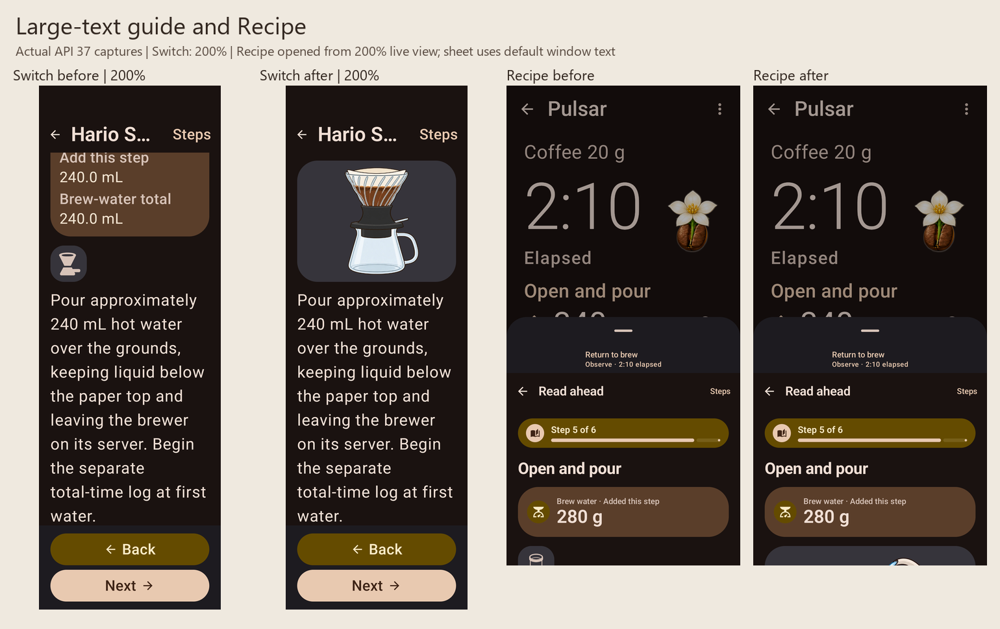

# Verification — 2026-10-25

## Result

All 344 shipped physical instruction contexts have an explicit current-contract binding to independently reviewed generated artwork. One additional generated live water-height cue is admitted separately. The 230 packaged 1024×768 alpha WebPs contain 205 distinct delivered images; the largest is 208,936 bytes, below the 300,000-byte limit.

This batch uses 124 new generated masters and 83 retained canonical P1 resources after renewed inspection. Retained artwork's older shading/backplate qualification is recorded in `reviews/legacy-renewal/retained-art-minimalism-qc-statement.json`. Original prompts, raw generator outputs, rejected attempts, independent reviews and superseded delivery records are retained.

## Checks performed

- Complete admission and generated catalog checks passed: 345 contexts, zero missing primary contexts, no ambiguous target bindings.
- Packaged instruction-asset verification passed for all 230 resources: dimensions, alpha, size, reviewed hashes, tracker consistency and provenance.
- All 478 staged drawable, original-master and exact-prompt Git blobs matched their admitted SHA-256 values. Scoped attributes preserve original prompt/QC evidence bytes across checkouts.
- Seven focused Python admission regressions passed, including changed bytes, rejected or incomplete QC, missing canonical Pulsar admission, canonical override attempts, ambiguous targets and stale contracts.
- 143 focused guidance JVM tests passed with zero failures/errors. Coverage reconstructs contracts from shipped source catalogs and checks actual decoded runtime identities; raw canonical recipe hashes remain independently asserted.
- Detekt passed. Debug app and Android-test APKs built successfully using the repository wrapper/JDK21 and an isolated `.minimalrefine` package suffix.
- Independent implementation review found and confirmed fixes for nullable live-image access, the old canonical Pulsar approval bypass and stale localized captions. Separate binding review corrected two Switch phase mappings. Final review found no remaining code or binding findings.

Initial build attempts exposed a removed duplicate resource during packaging and a resolver return-count finding; both were corrected before the successful batch. Initial JVM failures were corrected test fixtures/obsolete production expectations; an isolated rejected-required-frame regression preserves the release gate. Existing unrelated evidence blockers remain excluded.

## Native rendering and interaction

Used the existing stable API37 emulator (`emulator-5554`, preview SDK0), with no new/cloned AVD, lower-API run, global font/display change or actual application-data reset. Live screens and the Switch reader use normal text or a fixture-local 200% font scale; the Switch reader additionally uses a 320dp-wide viewport. Popup sheets use the emulator's default window font configuration: their captures demonstrate navigation from the 200% live view, not 200% sheet typography.

All six targeted scenarios passed:

| Scenario | Observed result |
| --- | --- |
| Basic Timer, normal text | Timer, completed bloom, target, Help and Finish remain reachable; reading Help does not finish the brew. |
| Basic Timer, 200% text | Same essential controls remain visible and operable. |
| Guided Pour, normal text | Cumulative target, generated water-height cue and primary action visible; Help retains quantities, source explanation, safety and completion. |
| Guided Pour, 200% text | Help and Recipe remain reachable; returning preserves stage/time and advancing requires the primary action. |
| Switch reader, 200% text at320dp | Reviewed image/accessible description visible; volume, post-fill clock origin, next-step navigation and state restoration preserved. |
| Chemex overview/reader | Coffee/water amounts preserved, brew callback reachable, and the admitted instructional image/description visible. |

Five scenarios passed in the first native batch (69.009s). Chemex initially exposed a test-fixture lazy-list lookup that could not find an action not yet composed below the new image. The fixture now scrolls the parent list to the text before asserting visibility/clicking. Only the test APK was rebuilt; the focused Chemex rerun passed (22.441s). Production code and the five successful scenarios were unchanged.

Before captures came from the earlier isolated minimal-brewing build, whose brewing UI matches the task baseline. After captures use this implementation based on main's `1600a1f6` cleanup. Comparison panels only label and proportionally resize actual screenshots; UI pixels were not redrawn.

- 
- 
- 
- 

Full-resolution native captures and execution logs remain locally under `src/build/guidance-art-review/`; Gradle/JUnit reports remain in the task checkout's ignored build directories.

## Limits

Image mechanics and binding coverage cover all344 physical contexts. Native execution covers the six scenarios above, not a runtime traversal of every method/step. Accessibility checks cover image descriptions, practical existing controls, large-text rendering and the exercised navigation; no full TalkBack session or physical-device check was performed. Brewing accuracy is reference-based with independent visual review; no physical brewing or calibrated image measurements are claimed. No remote publication or deployment was performed.
