# Brewing UI — before and after

Actual API37 native renders; screenshots are not mockups. Before is the unchanged layout at 7f359754 (with only shared renderer extraction for the six availability cases). After is this visual redesign. No screenshot pixels are redrawn.

The live matrix uses one frozen reviewed Pulsar stage: 2:10 elapsed, 340 g cumulative target and a completed bloom. Full includes its admitted water-height visual; partial keeps its supplied operation text and target without artwork; missing omits teaching content while retaining the authoritative action, target and controls. Normal is approximately 411 dp at 100%; large text is 320 dp at 200%, using fixture-local density without changing emulator settings.

| Guidance / text | Before | After |
| --- | --- | --- |
| Full / normal | 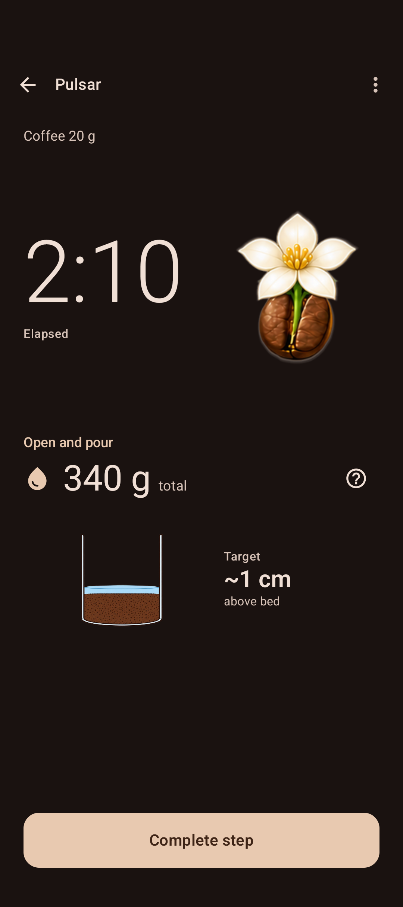 | 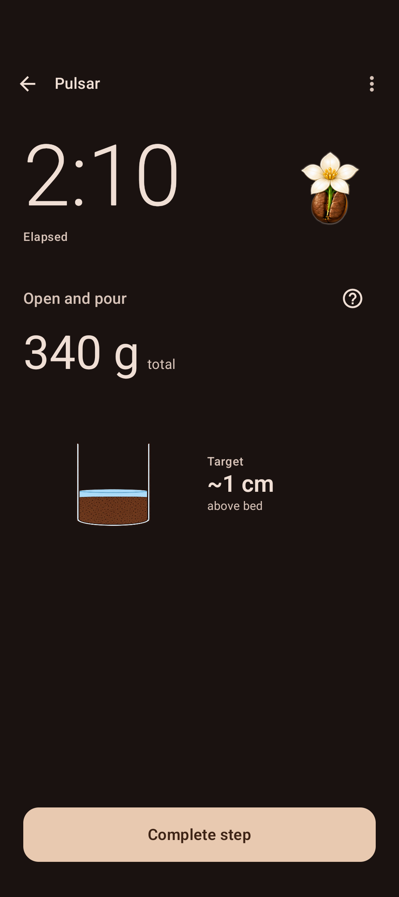 |
| Partial / normal | 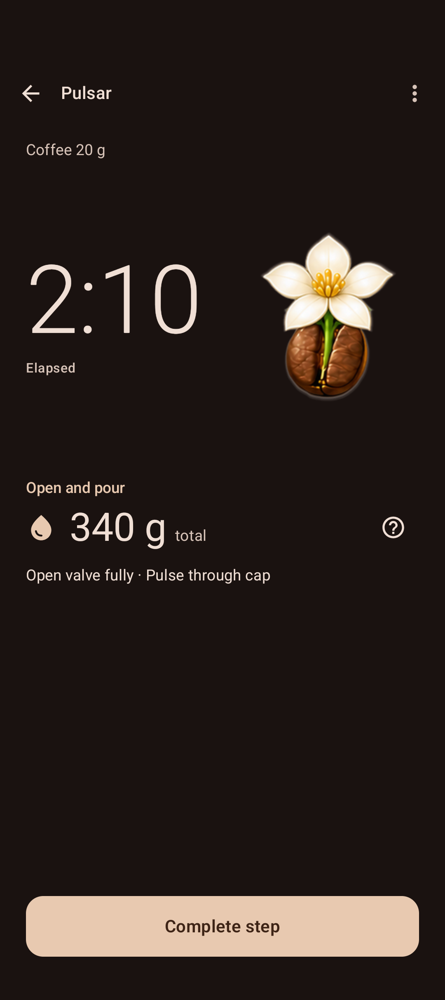 | 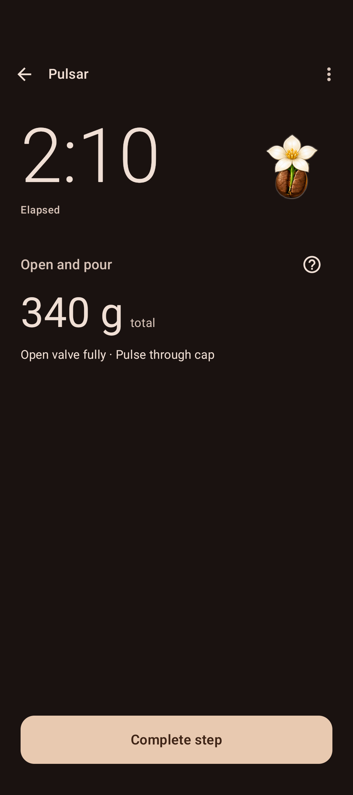 |
| Missing / normal | 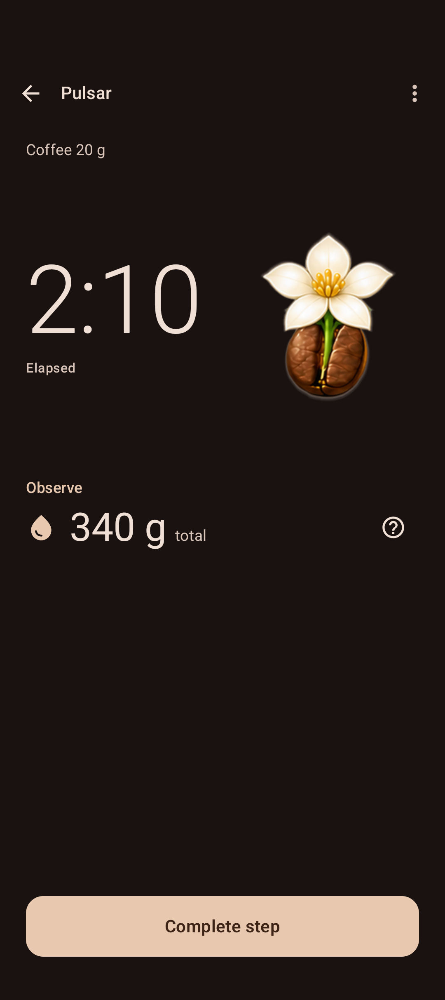 | 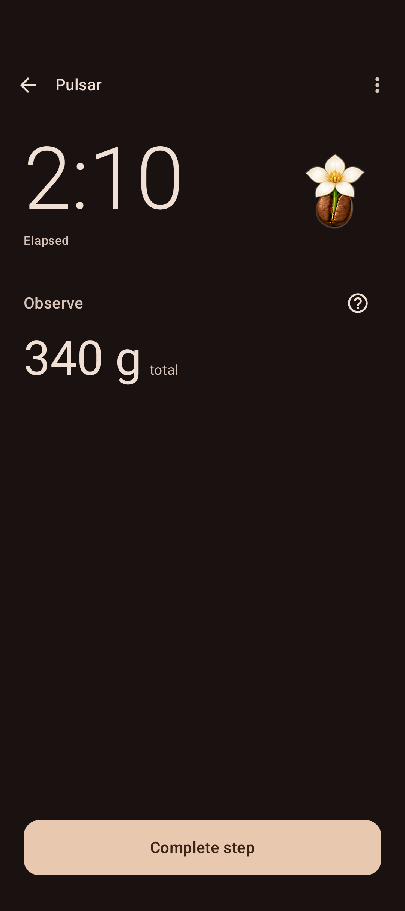 |
| Full / 200% | 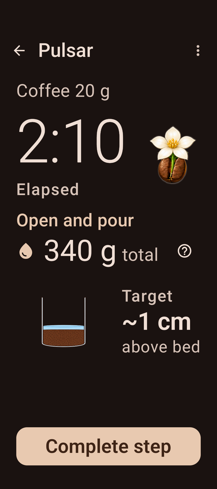 | 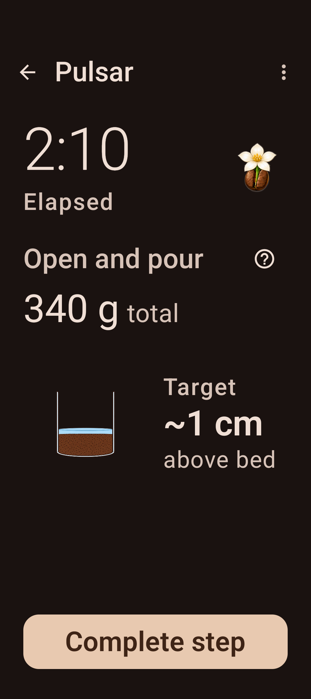 |
| Partial / 200% | 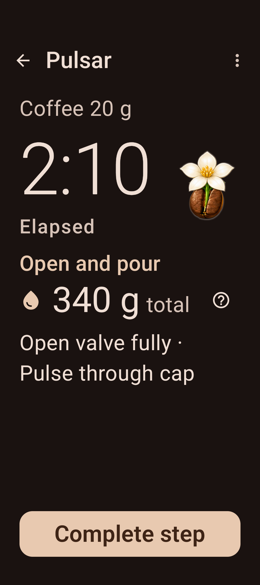 | 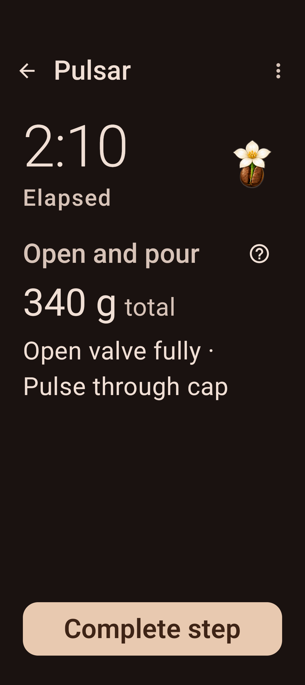 |
| Missing / 200% | 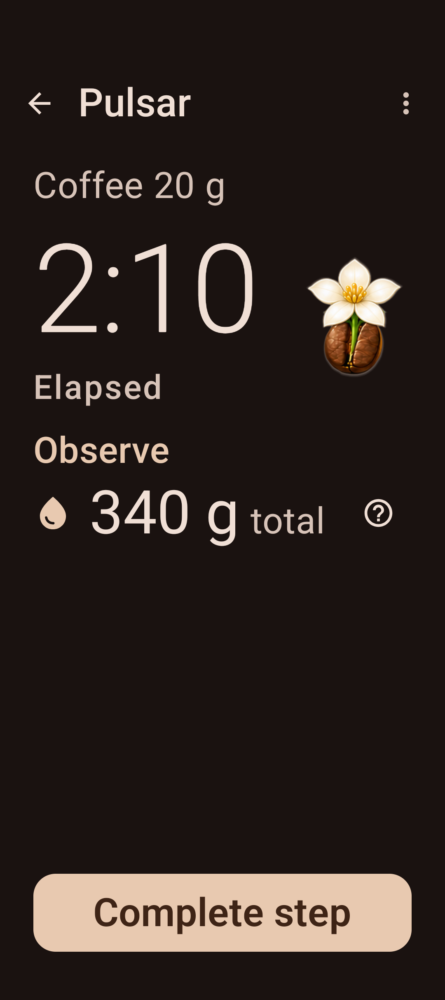 | 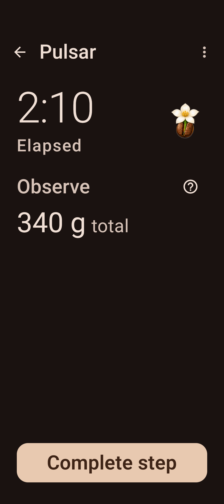 |

The following before captures reuse the matching verified 7f359754 renders already committed with the architecture work. The after captures use the same existing native fixtures. Popup sheets keep the emulator window font configuration; 200% live content does not establish 200% popup typography.

| Flow | Before | After |
| --- | --- | --- |
| Basic Timer / normal | 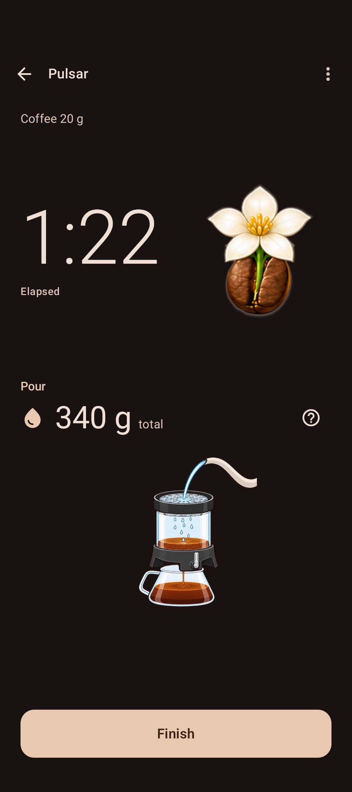 | 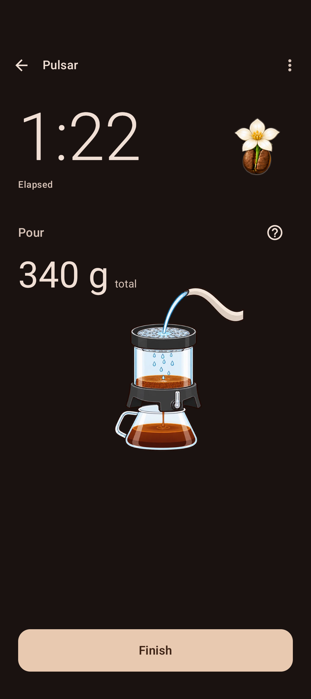 |
| Basic Timer / 200% | 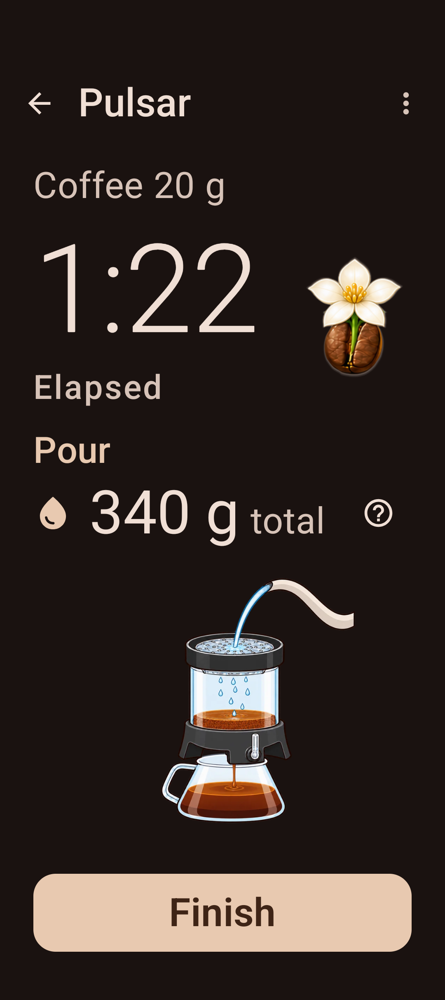 | 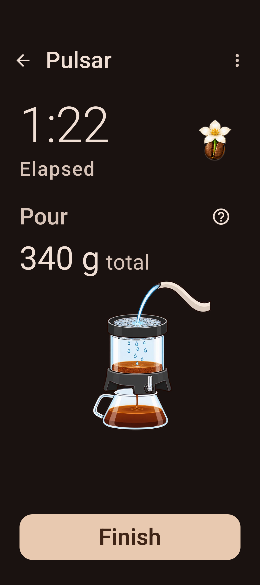 |
| Reviewed overview / normal | 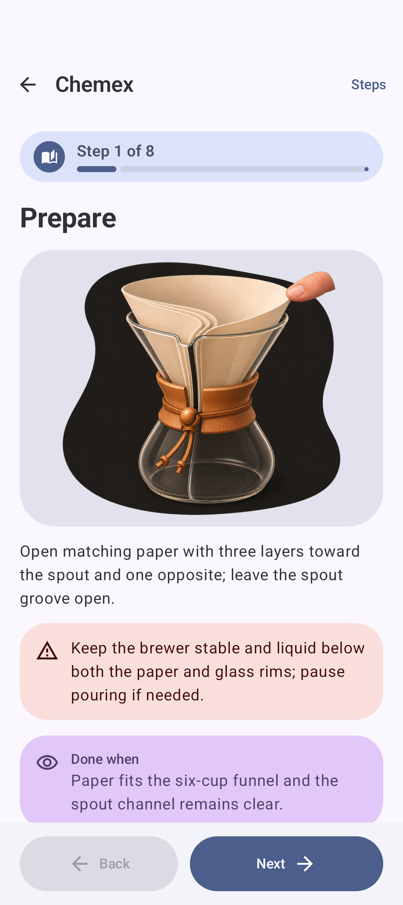 | 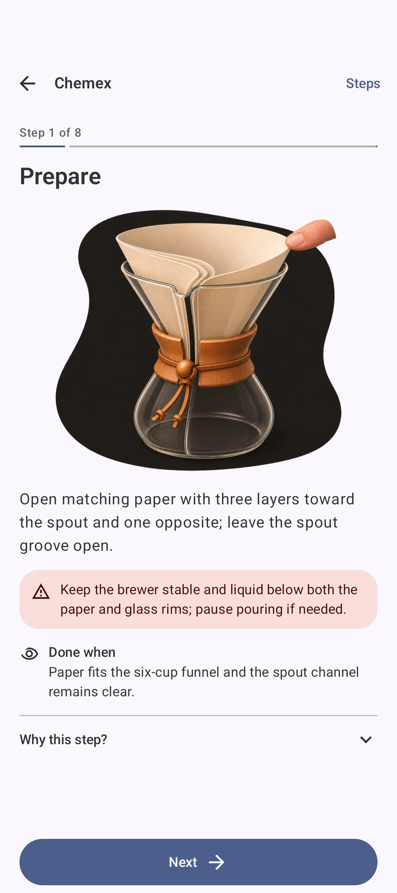 |
| Volume reader / 200% | 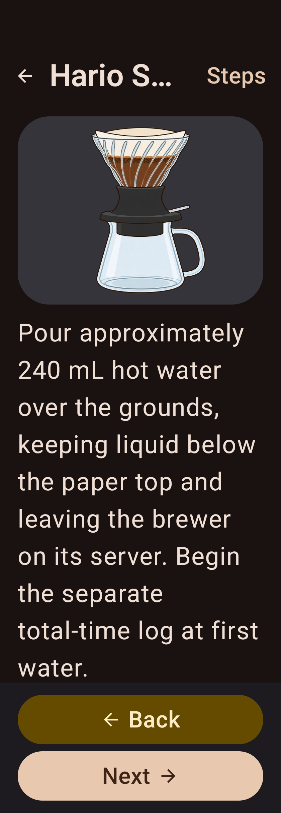 | 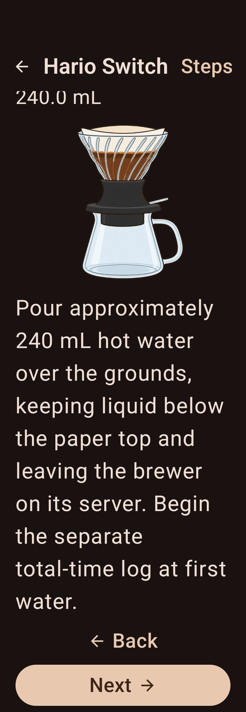 |
| Targets only / 200% | 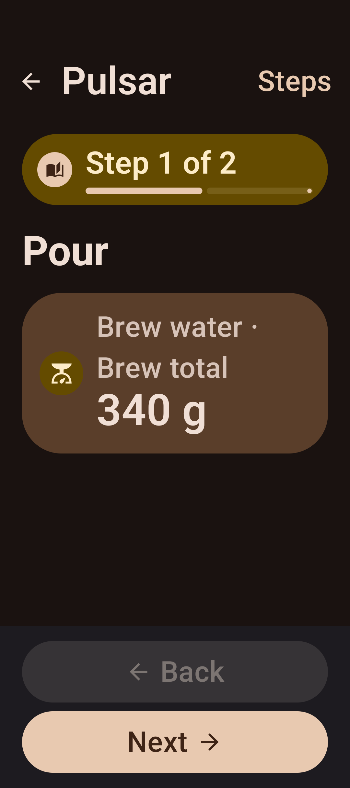 | 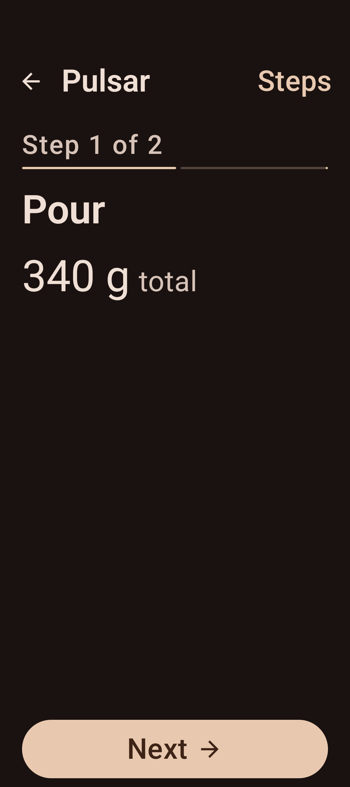 |
| Image only / normal | 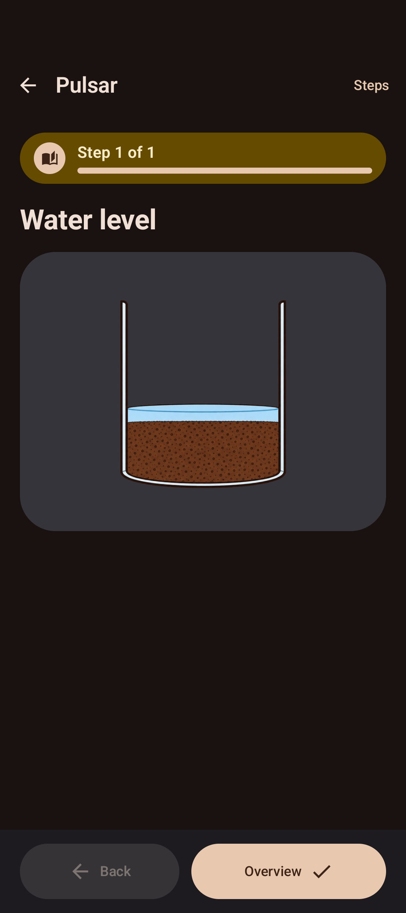 | 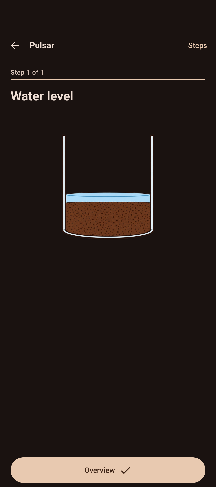 |
