# Original brewing UI restored on modular content

Before: verified native renders at 54b88926 (also the presentation at task baseline f4801d32). After: this restoration. Both use the same frozen source recipes. Images are unmodified native pixels.

Visual reference: the centered BrewTimerScreen in b44781a2^, before the minimal brewing-screen rework: bloom above the main target, compact elapsed time, supplied guidance card, and Finish with a circular physical-pause control. Current durable sessions and optional content modules remain authoritative.

Normal captures use the existing emulator viewport (~411 dp). Large live captures use fixture-local 200% text; the six guidance-availability cases also constrain width to 320 dp. This does not claim system-scaled popup typography.

| Flow | Before | After |
| --- | --- | --- |
| Basic Timer / normal | 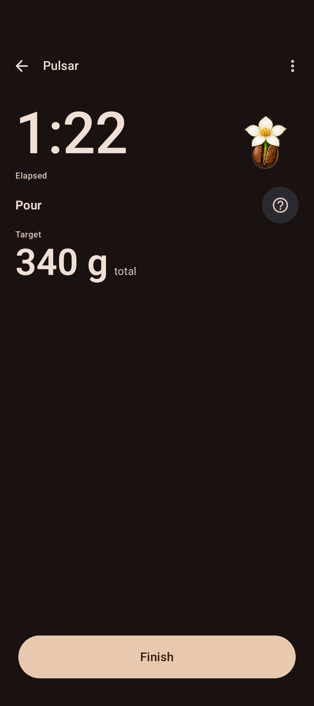 | 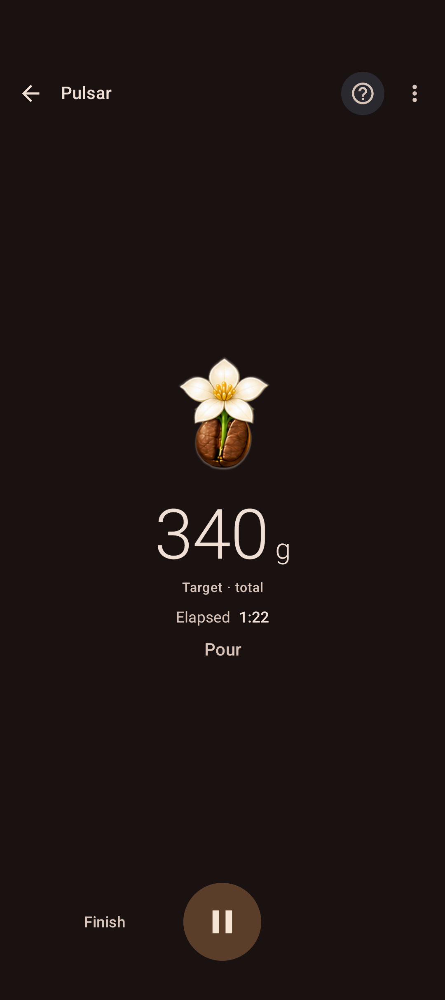 |
| Basic Timer / 200% | 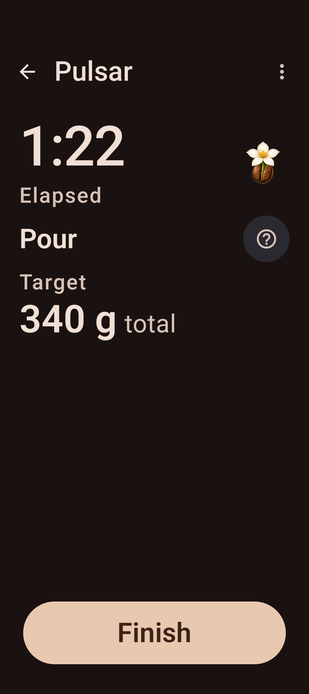 | 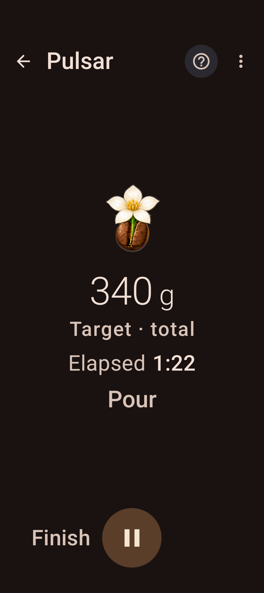 |
| Guided pour / full / normal | 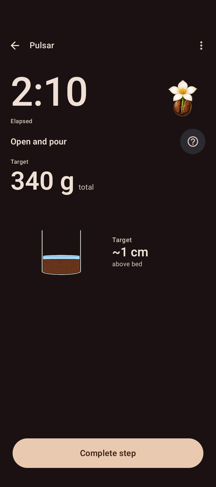 | 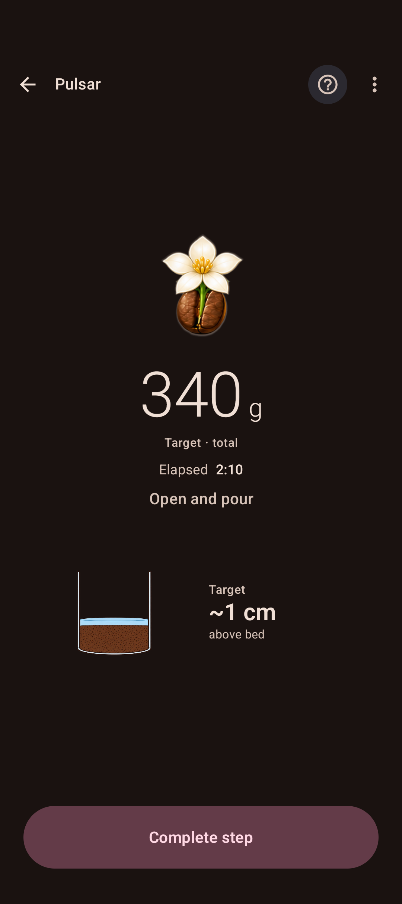 |
| Guided pour / full / 200% | 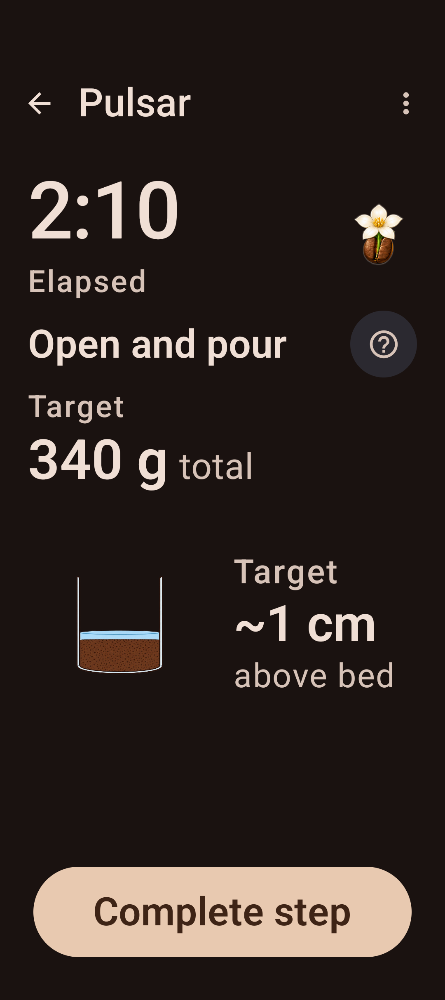 | 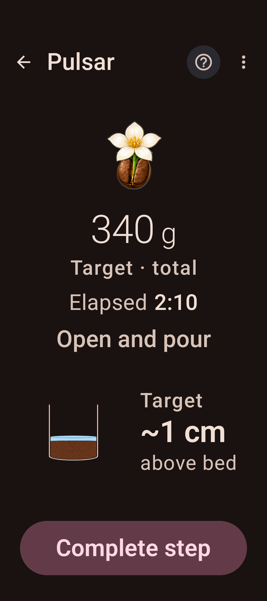 |
| Guided pour / partial / normal |  | 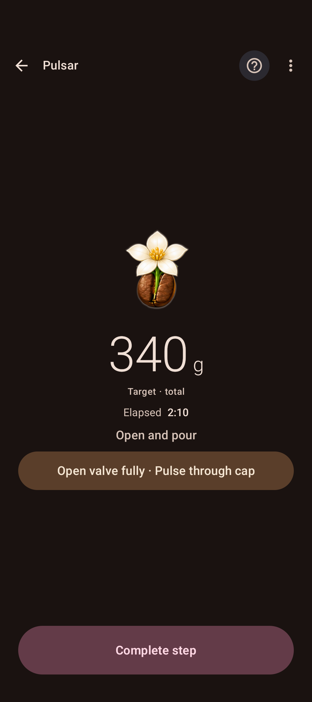 |
| Guided pour / partial / 200% | 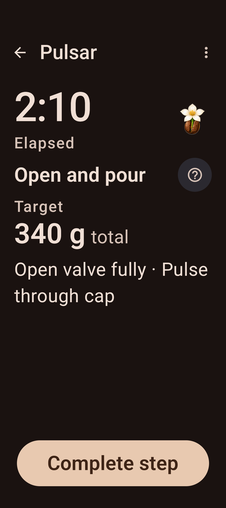 | 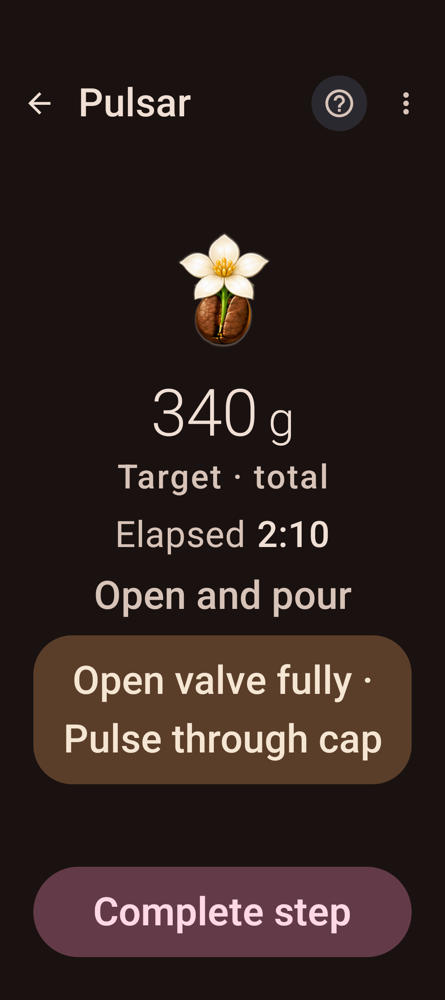 |
| Guided pour / missing / normal | 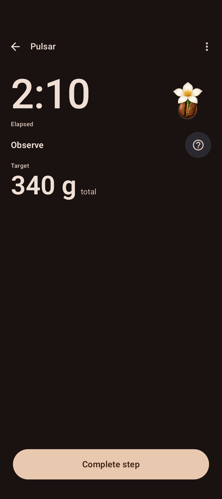 | 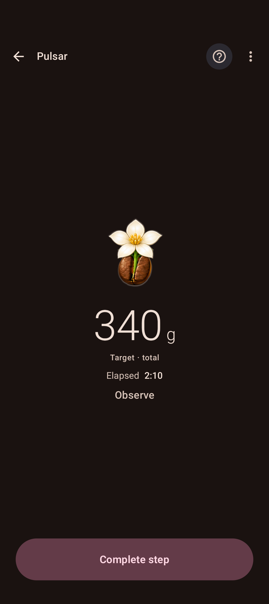 |
| Guided pour / missing / 200% | 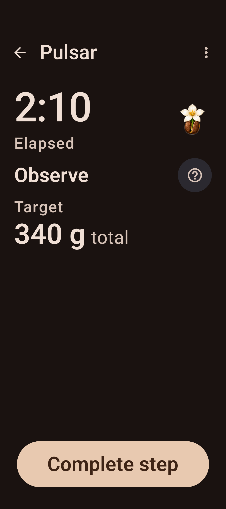 | 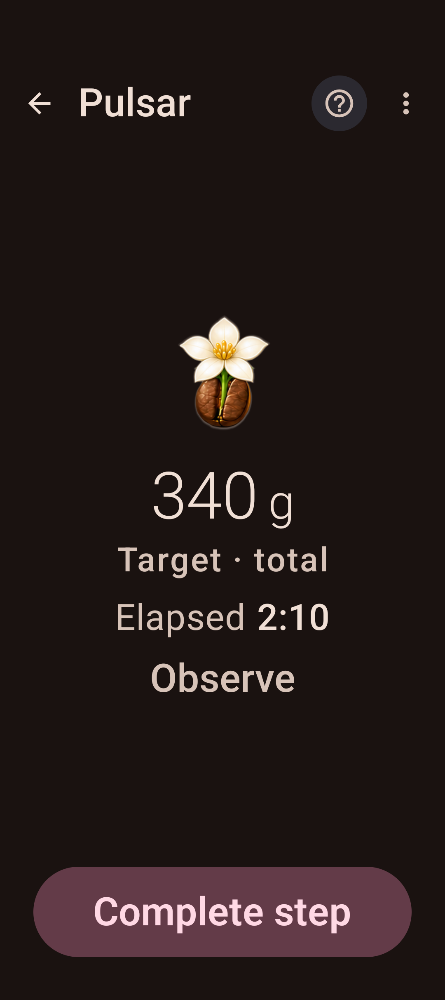 |

Paused controls (no matching pre-restoration fixture exists): [normal](evidence/after/original-basic-paused.png), [200% text](evidence/after/original-basic-paused-200.png). Finish stays available when permitted; the centered Play button resumes the physical clock. [Pressed guided action](evidence/after/primary-pressed.png) is captured before canceling the press without dispatching completion.
