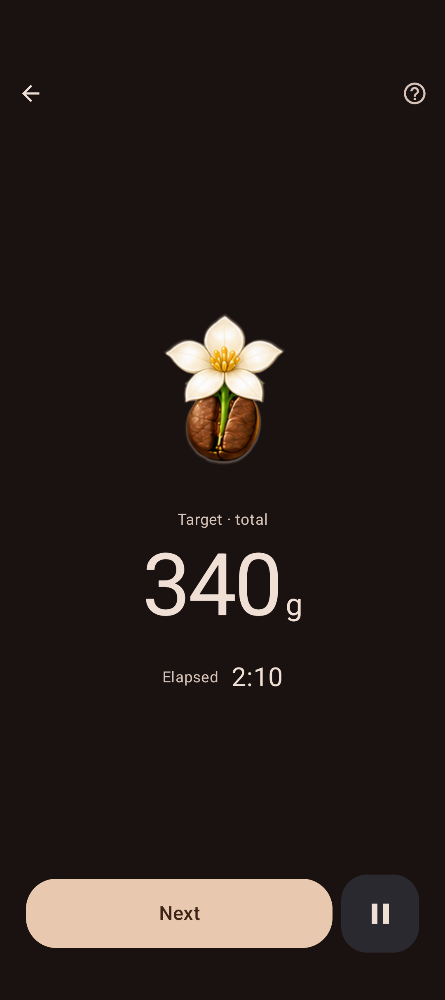
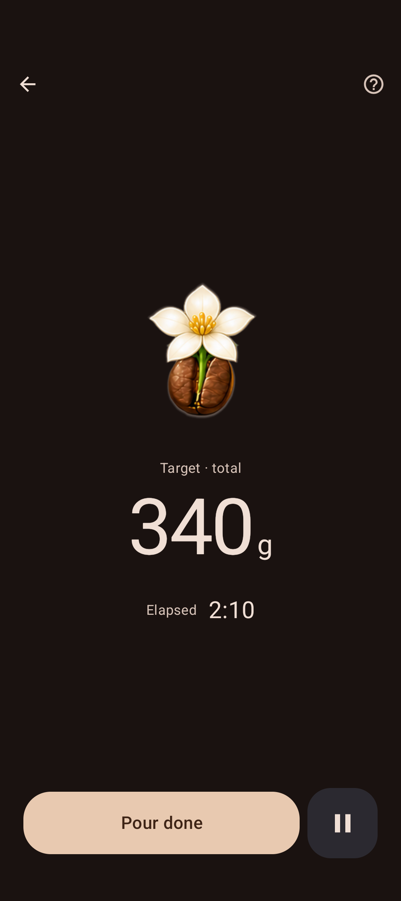
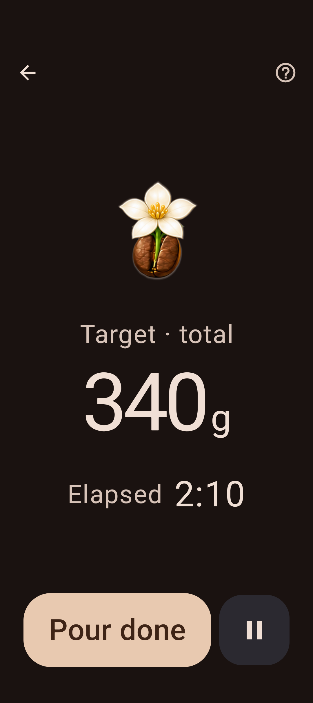

# Brewing step confirmations

The primary button confirms the current task, with no added instructions. Unknown or custom tasks use “Step done”. Start, pause, resume and finish keep their existing meaning.

Before: native frames from `e0e756a7`. After: the same frozen Pulsar stage, 340 g cumulative target and 2:10 elapsed, with the revised label. Large text uses a local 200% font scale at 320 dp; device settings stay unchanged.

| Size | Before | After |
|---|---|---|
| Normal |  |  |
| Large text |  |  |

Verification: 5 focused JVM tests passed; Detekt and isolated app/test APK builds passed. The packaged resources include the final English and Czech copy. Seven native checks passed on the existing API 37 REL emulator: full/partial/missing guidance at normal and 200%/320 dp, plus live-screen Help/Recipe, physical pause/resume and manual confirmation. Text-fit assertions passed. Native frames are untouched 1080 × 2424 captures. Device font scale stayed 1.0; no global display settings changed. Physical-device and TalkBack checks were not repeated for this label-only change.

Astra independently reviewed the final source and both before/after pairs and approved local commit/integration with no remaining findings.
